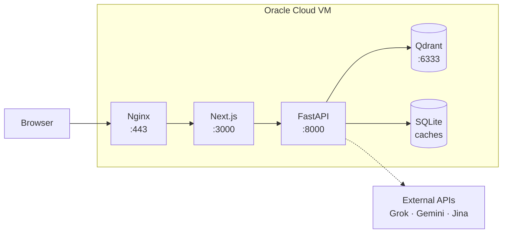
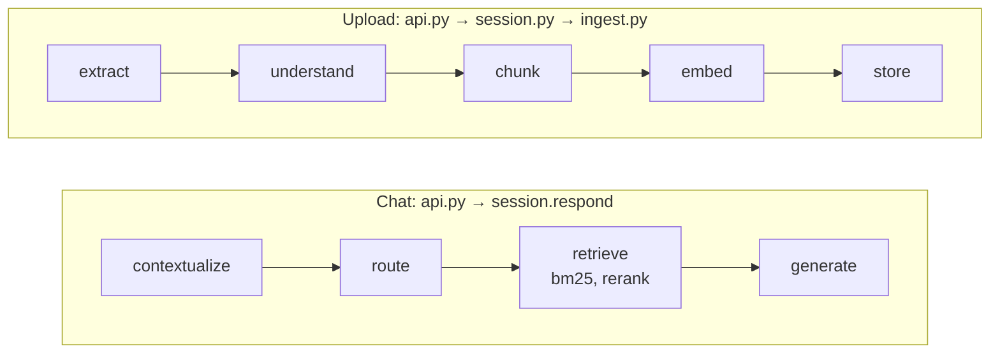
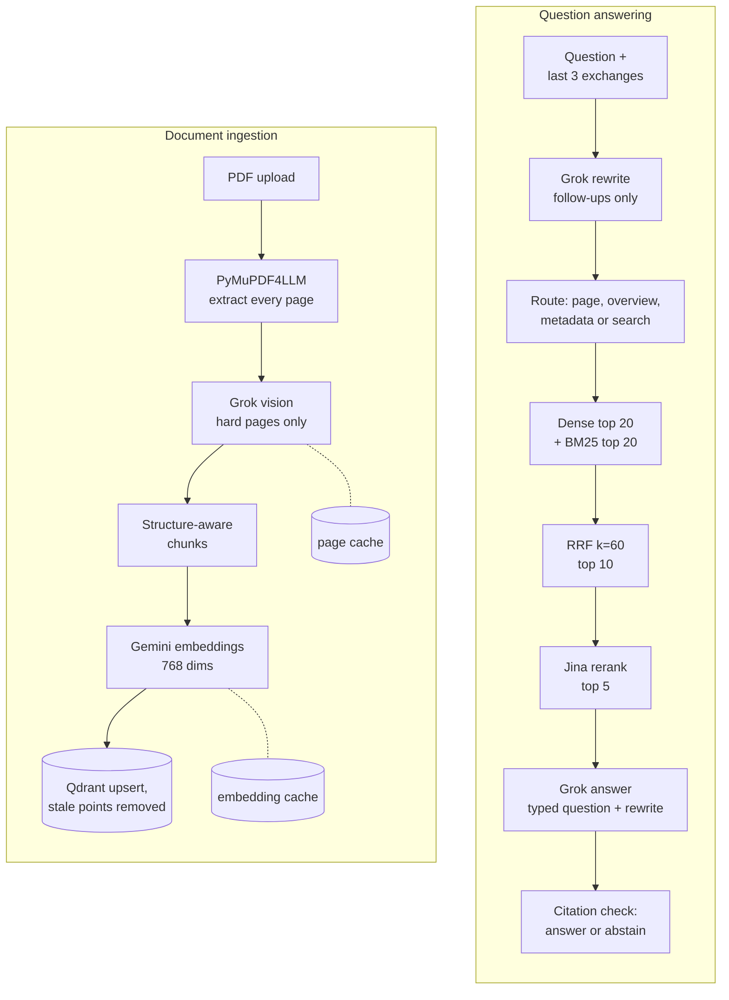

# Multimodal Enterprise RAG

A deployed question-answering app for PDFs. Upload documents, ask questions in English, Hindi or Hinglish, and get answers drawn only from those documents, with page citations and the passages behind them. Follow-up questions use the recent conversation.

Live demo: [tarun.runs-on.dev](https://tarun.runs-on.dev) · Code: [github.com/tarunkauxhik/multimodal-enterprise-rag](https://github.com/tarunkauxhik/multimodal-enterprise-rag)

## What it does

- Extracts every page fast, and sends only hard pages (scans, broken fonts, charts, sparse tables) to a vision model.
- Retrieves with dense search and BM25 together, fuses the rankings with RRF, and reranks with Jina.
- Cites `[document, Page N]` and checks every citation against the passages the model saw.
- Resolves follow-ups like "tell me more" or "what about page 4?" from the last 3 exchanges.
- Abstains when the documents don't cover a question, and refuses general-knowledge questions.

## Architecture

### High level design



Next.js renders the UI and forwards five allowlisted endpoints to FastAPI, where all RAG logic lives. Grok reads hard pages, rewrites follow-ups and writes answers; Gemini embeds; Jina reranks.

### Low level design



Each box is one plain Python module in `rag/`, with no LangChain or agent framework.

### Workflows



## How it works

**Selective ingestion.** PyMuPDF4LLM extracts every page. Grok sees a page only when the fast text is likely incomplete: a scan (under 50 characters and a large image), garbled text (≥ 1% U+FFFD), mostly a legacy Hindi font such as Kruti Dev, a large figure that isn't an event photo, or a table with half its cells empty. Its output is stored as document content, never as an answer.

**Hybrid retrieval.** Dense search covers paraphrase and cross-language questions. BM25 catches exact names and numbers, and its tokenizer keeps Devanagari words whole. Their scores aren't comparable, so ranks are fused with RRF (dense 20 + BM25 20, k=60, top 10). Jina reranks those to 5. BM25 is rebuilt from Qdrant payloads, so the two indexes can't drift. Page and overview questions skip search, since "page 72" has nothing to match. A question that names a document searches only that document.

**Follow-ups.** When a message has earlier turns, one short Grok call rewrites it into a standalone request ("and the next page?" becomes "What is on page 4 of SRS.pdf?"). Routing and retrieval use the rewrite. The generator gets the message as typed plus the rewrite, so the user's own instructions survive. Earlier answers never become evidence. First messages and small talk skip the call, and a new topic comes back unchanged.

**Grounding.** Retrieved text goes into delimited, untrusted `<source>` blocks. Each `[document, Page N]` must match a supplied passage, and invalid ones are removed. With none left, the app abstains. `INSUFFICIENT_CONTEXT` and `OUT_OF_SCOPE` are separate refusals, and neither falls back to general knowledge.

**Failure handling.** Grok and Jina calls retry 408, 429, 5xx and network errors with backoff; Gemini retries through its SDK. A reply cut off at the token limit raises an error instead of returning half an answer. A failed page-vision call keeps the fast text, and a failed rewrite keeps the typed message. Questions are capped at 2,000 characters and history at 3 turns. One ingestion runs and one waits; more get 429. Every Qdrant write is tagged with a `write_id` and chunk count, so a write cut short by a crash is never retrieved. All Grok calls run at low reasoning effort.

## Sessions, documents and caches

- **Chat history** lives in the browser tab's sessionStorage. It survives a reload and is gone when the tab closes. The server stores no conversations: each request carries its last 3 exchanges, answers cut to 1,500 characters. Separate tabs don't share history. This is not user identity or access control.
- **Documents** live in one shared Qdrant collection (`documents`). There are no accounts, so anyone who can reach the site can list, query and delete every document.
- **Deletion** removes all of the document's Qdrant points, and with them its listing and retrieval. The uploaded PDF is never written to disk. The SQLite caches are not touched, so the document's cached page results (extracted text) and embedding vectors stay on disk.
- **`embeddings.sqlite`** is keyed by sha256(model, dimensions, task, text) and stores the vector. Document chunks and questions are cached alike, and any repeated text is never re-embedded.
- **`understanding.sqlite`** is keyed by sha256(provider/model, prompt version, DPI, document, page, task) and stores Grok's JSON result. Only successes are cached.

Re-ingesting the same PDF reuses both caches, so even an interrupted run skips finished work. A new model or prompt version changes the key and forces a recompute. Neither cache expires or has a cleanup command.

## Deployment

Only Nginx is public: port 443 with a certbot certificate, and port 80 redirects to HTTPS. Next.js (`127.0.0.1:3000`), FastAPI (`127.0.0.1:8000`, one Uvicorn worker because upload jobs live in memory) and Qdrant in Docker (port 6333) are not reachable from the internet. The `rag-api` and `rag-web` systemd units and the Nginx site config are in [`deploy/`](deploy/).

GitHub Actions CI runs on every pull request and push to `main`. The backend job runs `uv sync --frozen` and pytest. The frontend job runs `npm ci`, Vitest, ESLint, `tsc` and a production build.

CD runs only after CI passes on `main`. Over SSH it refuses a dirty working tree, checks out the exact commit CI tested, and runs `uv sync --frozen`, `npm ci` and `npm run build`. It then restarts both services and waits up to 30 s each for the API and web app to answer locally.

**Access control.** The app implements no authentication or authorization. [`deploy/nginx.conf`](deploy/nginx.conf) enables Nginx basic auth for the whole site, but the live demo currently loads without a login. Treat anything uploaded there as public.

## Tech stack

| Area | Used |
|---|---|
| Frontend | Next.js 16, React 19, TypeScript, Tailwind CSS 4, shadcn/ui |
| Backend | Python 3.12, FastAPI, httpx, uv |
| Models | xAI `grok-4.7`, Google `gemini-embedding-2` (768 dims), Jina `jina-reranker-v3` |
| Documents and retrieval | PyMuPDF4LLM, Qdrant (cosine), rank-bm25, SQLite caches |
| Ops | Oracle Cloud VM, Nginx, systemd, Docker, GitHub Actions |

## Run locally

You need [uv](https://docs.astral.sh/uv/), Node.js 22.22+ or 24.15+, Docker, and keys for xAI, Gemini and Jina. The API won't start without the keys; the offline tests don't need them.

```bash
uv sync
docker run -d --name rag-qdrant -p 127.0.0.1:6333:6333 -v rag_qdrant_storage:/qdrant/storage qdrant/qdrant:latest
cp .env.example .env        # Windows: copy .env.example .env, then add your keys
uv run uvicorn api:app --host 127.0.0.1 --port 8000 --workers 1
```

Then, in a second terminal:

```bash
cd web
npm ci
npm run dev -- --hostname 127.0.0.1    # http://127.0.0.1:3000
```

`.env.example` lists the variables. The required ones are `XAI_API_KEY`, `GEMINI_API_KEY` and `JINA_API_KEY`. The optional ones (`XAI_BASE_URL`, `QDRANT_URL`, `QDRANT_API_KEY`) default to the public xAI endpoint and local Qdrant.

## Testing

```bash
uv run pytest                                   # backend, offline
cd web && npm test && npm run lint && npm run typecheck && npm run build
RAG_LIVE_TESTS=1 uv run pytest tests/test_live_retrieval.py -v -s   # opt-in, real APIs
```

The backend suite runs against in-memory Qdrant with fake models. It covers extraction, page routing, chunking, RRF, citation validation, the follow-up rewrite, the HTTP API and write completeness. The frontend tests use Vitest and Testing Library, with proxy validation and an axe-core accessibility check. The live multilingual retrieval test is skipped in CI.

## Evaluation

[`evals/gold.jsonl`](evals/gold.jsonl) has 30 questions over three public annual reports (NITI Aayog in English and Hindi, and a bilingual Ministry of Heavy Industries report). They cover English, Hindi, Hinglish, cross-language, tables, visual pages, one unanswerable question and one prompt injection.

`uv run python -m evals.benchmark` compares dense, BM25, RRF and RRF + Jina on retrieval only. It reports Recall@5, Recall@10, MRR@10 and nDCG@10 into `evals/results/`. It needs the PDFs in `evals/docs/` (not committed), a running Qdrant and the keys in `.env`. Only Gemini and Jina are called. No results have been recorded yet, so no scores are claimed.

## Limitations

- No accounts and one shared workspace (see Access control).
- Grok 4.7 replaced the benchmarked MiniMax-M3 without a re-run.
- Citation checks confirm a cited page was supplied, not that it supports the sentence.
- Page and chat routing are heuristics. Vector-drawn charts are missed.
- Follow-ups see only 3 exchanges. Document scoping applies only when the rewrite names the file.
- Single process, in-memory job state, not load-tested.
