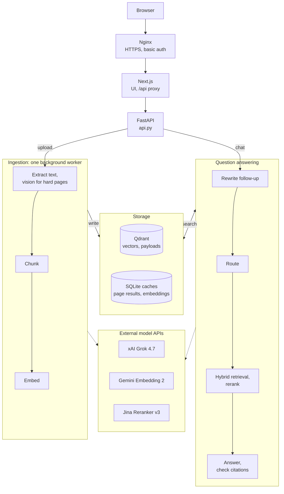
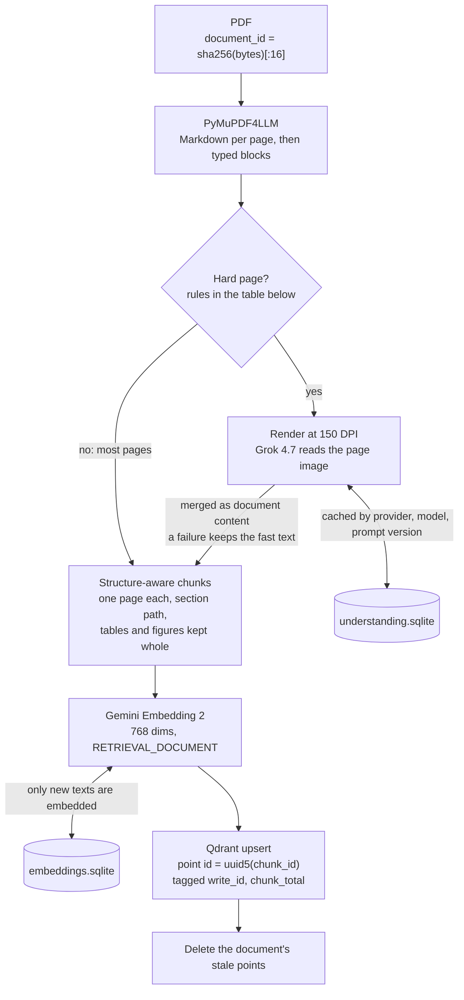
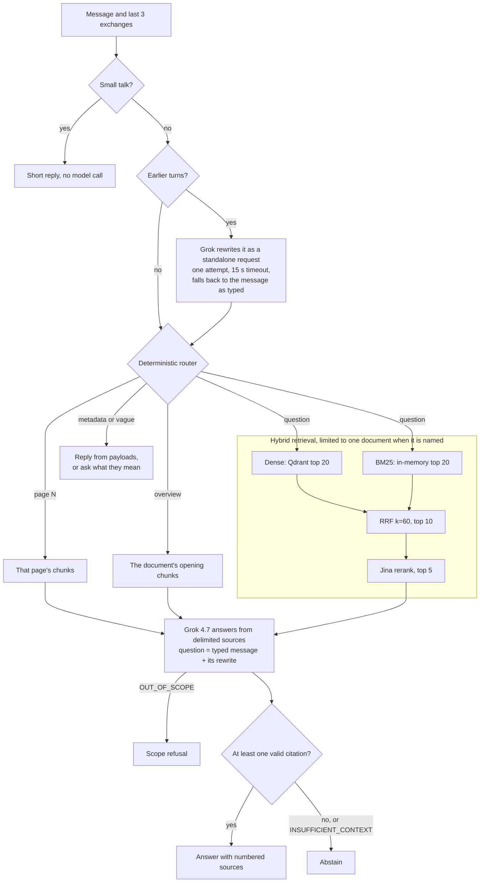

# Multimodal Enterprise RAG

A deployed document question-answering app. You upload PDFs, ask questions, and get answers that come only from those documents, with page citations. Follow-up questions use the recent conversation, and each answer shows the passages behind it. It handles English and Hindi PDFs, and questions in English, Hindi or Hinglish.

Live demo: [tarun.runs-on.dev](https://tarun.runs-on.dev) · Code: [github.com/tarunkauxhik/multimodal-enterprise-rag](https://github.com/tarunkauxhik/multimodal-enterprise-rag)

## What it does

- Upload PDFs up to 200 MB. Processing runs in the background and the UI shows each stage.
- Read hard pages (scans, broken fonts, charts, sparse tables) with a vision model. Other pages keep fast text extraction.
- Retrieve with dense search and BM25 together, fuse the rankings, then rerank.
- Cite sources as `[document, Page N]`. Citations are checked against the passages the model actually saw.
- Resolve follow-ups like "tell me more" or "what about page 4?" from the last 3 exchanges.
- Say so when the documents don't cover a question, and refuse general-knowledge questions.

## High level design



Next.js only renders the UI and forwards five allowlisted endpoints to FastAPI. All RAG logic lives in `rag/`, one module per stage. Grok handles page vision, the follow-up rewrite and answers. Gemini embeds documents and queries, and Jina reranks. Ingestion progress is kept in memory, and SQLite only caches model results.

## Low level design

### Ingestion



### Question answering



## Engineering decisions

### Selective multimodal ingestion

Sending every page to a vision model is slow and costly. So PyMuPDF4LLM extracts every page first, and a deterministic check sends a page to Grok only when the fast text is likely incomplete.

| Signal | Rule | Grok output stored as |
|---|---|---|
| Scanned | < 50 non-space characters and an image over ~40% of the page | `figure` blocks |
| Garbled | ≥ 1% U+FFFD replacement characters | re-transcribed text |
| Legacy Hindi font | ≥ 50% of Latin letters in a known pre-Unicode font (Kruti Dev, Arjun), or a matching text fingerprint | re-transcribed text |
| Informative figure | large figure whose caption is not an event photo ("Glimpses…", "Hon'ble…") | figure description |
| Sparse table | ≥ 50% of data cells empty | re-extracted table |

Grok's output is stored as document content, never as an answer. It is chunked and embedded like any other text. Results are cached by provider and model, so a model change never reuses old page results.

### Hybrid retrieval

Dense search handles paraphrase and cross-language questions. BM25 catches exact names, numbers and codes, and its tokenizer keeps Devanagari words whole. Their scores aren't comparable, so the app fuses ranks with Reciprocal Rank Fusion: dense top 20 and BM25 top 20, k=60, top 10. Jina then reranks those 10 against the question and keeps 5 for the answer.

The BM25 index is rebuilt in memory from the chunk payloads in Qdrant. There is one source of truth, so the two indexes can't drift. Page and overview questions skip semantic search entirely, because "what is on page 72?" has nothing to match.

### Conversational RAG

The browser keeps the chat and sends the last 3 answered exchanges with each question. When a message has earlier turns, one short Grok call rewrites it into a standalone request. "And the next page?" becomes "What is on page 4 of SRS.pdf?". The existing router and retrieval then treat it like a first message.

Three things stay separate:

- The rewrite drives routing and retrieval.
- The generator answers the message as typed, with the rewrite attached as its reading. A formatting or language instruction in the original survives.
- Evidence comes only from retrieved chunks. Earlier answers shape the request but never reach the generator as sources.

First messages and small talk skip the rewrite, since there is nothing to resolve. A question that names a document, directly or through the rewrite, only retrieves from that document. A new, unrelated question comes back from the rewrite unchanged.

### Other choices

| Area | Chosen | Tried | Why |
|---|---|---|---|
| PDF extraction | PyMuPDF4LLM | Docling | Docling was accurate but too slow for this use |
| Vision and answers | xAI Grok 4.7 | MiniMax-M3 | M3 was the benchmarked model; its gateway is unavailable, so Grok replaced it |
| Embeddings | Gemini Embedding 2 | BGE-M3, Qwen3-Embedding | Local models were slow or English-focused |
| Orchestration | Plain Python modules | (none) | No LangChain or LangGraph: the pipeline is linear and easy to debug |

Grok always reasons and can't switch it off. It returns that reasoning in a separate field the app never reads. All three Grok roles run at `reasoning_effort="low"`. Reading a page, rewriting a question and answering from five passages don't need deep reasoning, and low effort is faster and cheaper.

## Guardrails and failure handling

- Retrieved text goes into delimited, untrusted `<source>` blocks, and the rules are restated after them. Instructions hidden in a PDF are treated as content.
- Each `[document, Page N]` must match a passage that was supplied. Invalid citations are removed. If none remain, the app abstains.
- There are two refusals: not enough evidence (`INSUFFICIENT_CONTEXT`) and not about the documents (`OUT_OF_SCOPE`). Neither falls back to general knowledge.
- A failed or slow rewrite (one attempt, 15 s timeout) falls back to the message as typed. Grounding is unchanged.
- Model calls retry 408, 429, 5xx and network errors with backoff. A reply cut off at the token limit raises an error instead of returning half an answer. API keys are redacted from errors.
- Inputs are bounded. Questions are capped at 2,000 characters and history at 3 turns. Uploads are capped at 200 MB, with one ingestion running and one queued; further uploads get 429.
- Every Qdrant write carries a `write_id` and `chunk_total`. A partial or interrupted write is never retrieved, and it shows as incomplete until the file is uploaded again.
- A failed page-vision call keeps the fast extraction for that page.
- The UI renders document text as plain text and answers without HTML. The proxy drops internal ids and server error details from every reply.

## Performance

No latency benchmark is published, and response time depends mostly on the external model APIs. The design avoids work where it can. The vision model sees only flagged pages. SQLite caches embeddings (documents and queries) and page results, so re-running an ingestion, even an interrupted one, skips work already done. BM25 runs in memory next to the API. The rewrite runs only on follow-ups, history is capped, and Grok runs at low reasoning effort.

## Tech stack

| Area | Used |
|---|---|
| Frontend | Next.js 16, React 19, TypeScript, Tailwind CSS 4, shadcn/ui, react-markdown |
| Backend | Python 3.12, FastAPI, Uvicorn, httpx, uv |
| Documents | PyMuPDF4LLM |
| Models | xAI `grok-4.7` (page vision, follow-up rewrite, answers), Google `gemini-embedding-2` (768 dims) |
| Retrieval | Qdrant (cosine), rank-bm25, Jina `jina-reranker-v3` |
| State | SQLite caches, in-memory job state, chat history in the browser's sessionStorage |
| Deployment | Oracle Cloud VM, Nginx, systemd, Qdrant in Docker, GitHub Actions |

## Run locally

You need [uv](https://docs.astral.sh/uv/) (it fetches Python 3.12 if missing), Node.js 22.22+ or 24.15+, Docker for Qdrant, and API keys for xAI, Gemini and Jina. The API won't start without the keys; the offline tests don't need them.

```bash
uv sync
docker run -d --name rag-qdrant -p 127.0.0.1:6333:6333 -v rag_qdrant_storage:/qdrant/storage qdrant/qdrant:latest
cp .env.example .env        # Windows: copy .env.example .env, then add your keys
uv run uvicorn api:app --host 127.0.0.1 --port 8000 --workers 1
```

In a second terminal:

```bash
cd web
npm ci
npm run dev -- --hostname 127.0.0.1    # http://127.0.0.1:3000
```

| Variable | Needed | Purpose |
|---|---|---|
| `XAI_API_KEY`, `GEMINI_API_KEY`, `JINA_API_KEY` | yes | Grok, embeddings, reranking |
| `XAI_BASE_URL` | no | Default `https://api.x.ai/v1` |
| `QDRANT_URL`, `QDRANT_API_KEY` | no | Default `http://127.0.0.1:6333`; key only if Qdrant needs one |
| `API_COLLECTION`, `API_MAX_UPLOAD_MB` | no | Workspace collection (`documents`), upload limit (200) |
| `RAG_API_URL` | no | Where Next.js reaches FastAPI, default `http://127.0.0.1:8000` |

Only the API reads keys, from the environment or a gitignored `.env`. The web app holds no secrets.

## Testing and CI/CD

```bash
uv run pytest                                   # backend, offline
cd web && npm test && npm run lint && npm run typecheck && npm run build
RAG_LIVE_TESTS=1 uv run pytest tests/test_live_retrieval.py -v -s   # opt-in, real APIs
```

The backend suite runs offline against in-memory Qdrant with fake embedders and models. It covers extraction, page routing, chunking, RRF, citation validation, the follow-up rewrite, the HTTP contract and write completeness. The frontend uses Vitest and Testing Library, including proxy validation and an axe-core accessibility check. The live test sends English, Hindi, Hinglish and cross-language queries through real Gemini, Jina and Qdrant. CI skips it.

[`evals/`](evals/) holds a 30-question gold set over three public annual reports and a retrieval benchmark script (Recall@5/10, MRR@10, nDCG@10). The PDFs are not committed, and no scores are published yet.

CI runs on every pull request and every push to `main`. The backend job runs `uv sync --frozen` and pytest. The frontend job runs `npm ci`, Vitest, ESLint, `tsc` and a production build.

CD starts only when CI passes on a push to `main`:

1. It connects to the Oracle Cloud VM over SSH and refuses to deploy over a dirty working tree.
2. It checks out the exact commit CI tested.
3. It runs `uv sync --frozen`, `npm ci` and `npm run build`.
4. It restarts the `rag-api` and `rag-web` systemd services.
5. It waits up to 30 s for each service to answer locally, then confirms both are active.

In production, Nginx terminates HTTPS (certbot) and caps uploads at 200 MB, and its site config enables basic auth. Behind it run the Next.js standalone server, one Uvicorn worker and Qdrant in Docker, all on localhost. There is one worker because upload jobs live in memory. Unit files and the site config are in [`deploy/`](deploy/).

## Limitations

- There is no app-level login and one shared workspace. Anyone who reaches the site can read and delete every document, so Nginx basic auth is the only gate.
- The pipeline was benchmarked with MiniMax-M3. Grok 4.7 replaced it without a re-run.
- Citation checks confirm a cited page was supplied, not that it supports the sentence.
- Page routing and chat routing are heuristics. Vector-drawn charts are missed, and a little legacy-font text on a mostly English page stays garbled.
- Follow-ups see only 3 exchanges. Document scoping applies only when the rewrite names the file.
- Page numbers are physical PDF pages, which can differ from printed page labels.
- It runs as a single process with in-memory job state, and it hasn't been load-tested.
